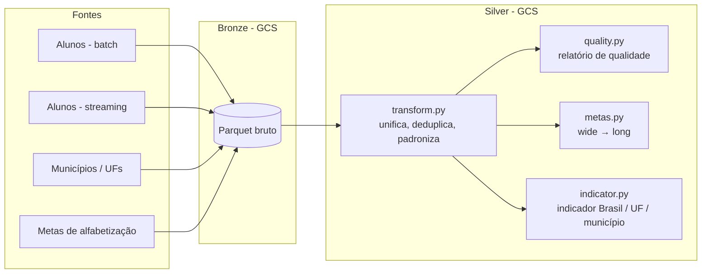

# 📚 Pipeline de Dados — Indicador de Alfabetização


Pipeline híbrida de dados (**batch + streaming**) que integra diferentes fontes relacionadas ao **indicador de alfabetização**, com foco em qualidade, escalabilidade e eficiência de custos em nuvem.

> Projeto desenvolvido na Fase 2 da pós-graduação em Data Science e IA (FIAP).

## 🏗️ Arquitetura

O projeto segue a **arquitetura Medallion**. Este repositório contém a **camada Silver**: tratamento, validação de qualidade e cálculo dos indicadores.



## ⚙️ O que cada etapa faz

| Etapa | Script | Responsabilidade |
|---|---|---|
| Transformação | `silver/transform.py` | Une batch + streaming, remove duplicidades por aluno/ano, padroniza tipos, cria a flag de registro válido e recalcula a alfabetização pelo corte de proficiência |
| Qualidade | `silver/quality.py` | Gera relatório com duplicados, nulos, registros válidos, peso nulo, municípios inválidos e divergências no corte |
| Metas | `silver/metas.py` | Converte as tabelas de metas de formato *wide* para *long* e padroniza tipos |
| Indicadores | `silver/indicator.py` | Calcula o percentual de alunos alfabetizados (ponderado pelo peso amostral) por Brasil, UF e município |

### Regras de negócio

- **Registro válido:** aluno presente na avaliação **e** com caderno preenchido.
- **Alfabetizado:** proficiência **≥ 743** pontos.
- **Indicador:** soma dos pesos dos alunos alfabetizados ÷ soma total dos pesos × 100.

## 📁 Estrutura

```
.
├── config.py           # Variáveis de ambiente (projeto, buckets, datasets)
├── utils.py            # Leitura e escrita de Parquet no Cloud Storage
├── silver/
│   ├── transform.py    # Tratamento Bronze → Silver
│   ├── quality.py      # Relatório de qualidade
│   ├── metas.py        # Tratamento das metas
│   └── indicator.py    # Cálculo dos indicadores
├── requirements.txt
└── .env.example
```

## 🚀 Como executar

```bash
# 1. Instalar dependências
pip install -r requirements.txt

# 2. Configurar variáveis de ambiente
cp .env.example .env   # e preencha com os dados do seu projeto GCP

# 3. Autenticar no Google Cloud
gcloud auth application-default login

# 4. Rodar as etapas, a partir da raiz do projeto
python -m silver.transform
python -m silver.quality
python -m silver.metas
python -m silver.indicator
```

## 🛠️ Tecnologias

Python · Pandas · PyArrow · Google Cloud Storage · BigQuery

## 👤 Autor

**Matheus Cadoni** · [LinkedIn](https://www.linkedin.com/in/matheus-cadoni-aab94a208) · [GitHub](https://github.com/Matheus074)
