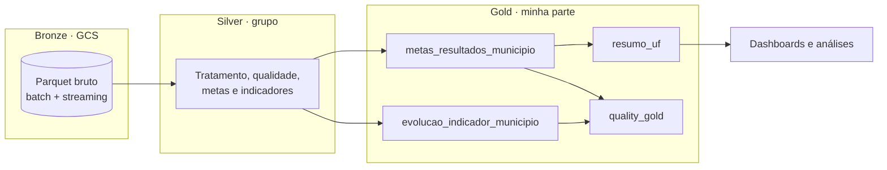

# 📚 Pipeline de Dados — Indicador de Alfabetização (Camada Gold)


Pipeline híbrida de dados (**batch + streaming**) que analisa o **Indicador Criança Alfabetizada** no Brasil, em arquitetura Medallion (Bronze → Silver → Gold) no Google Cloud.

> 👥 **Projeto em grupo**, desenvolvido na Fase 2 da pós-graduação em Data Science e IA (FIAP).
> O projeto completo, com ingestão Bronze, streaming via Pub/Sub e documentação do grupo, está em
> **[Bruno-iwamura/pos-fase-2-alfabetizacao](https://github.com/Bruno-iwamura/pos-fase-2-alfabetizacao)**.
>
> 🙋 **Minha contribuição foi a camada Gold**, que é o foco deste repositório.

## 🏗️ Arquitetura



## 🥇 Camada Gold

Tabelas analíticas no **BigQuery**, prontas para dashboards, análises estatísticas e Machine Learning.

| Tabela | O que entrega |
|---|---|
| `metas_resultados_municipio` | Indicador de cada município comparado com a sua meta: diferença em pontos e se a meta foi atingida |
| `evolucao_indicador_municipio` | Indicador de 2023 vs. 2024 por município, variação em pontos e classificação (melhorou, piorou ou estável) |
| `resumo_uf` | Visão executiva por UF: média do indicador e da meta e percentual de municípios que atingiram a meta |
| `quality_gold` | Validações de qualidade: nulos e duplicidades nas tabelas Gold |

### 💰 FinOps: decisões de custo

- Leitura **apenas das colunas necessárias** (sem `SELECT *`)
- **Filtros aplicados antes** das agregações e dos `JOIN`s
- **Deduplicação das metas antes do `JOIN`**, com `QUALIFY ROW_NUMBER()`, para evitar multiplicação de registros
- Tabelas Gold **consolidadas**, para que dashboards não consultem repetidamente a Silver detalhada
- `CREATE OR REPLACE TABLE` para reconstruir as tabelas sem versões intermediárias
- `SAFE_DIVIDE` nos percentuais, evitando falhas de divisão por zero
- Tabela resumida por UF para consultas executivas, sem acessar o nível municipal

**Custo x performance:** o processamento pesado fica no pipeline, que roda poucas vezes. As consultas dos dashboards, que rodam com muito mais frequência, leem tabelas pequenas e já agregadas. O volume da Gold é pequeno, então não usei particionamento. Se novos anos forem incluídos, a evolução natural é particionar por período e aplicar clustering por UF e município.

### 🤖 Aplicações em IA

A Gold foi estruturada para servir de base a:

- **Predição de alfabetização:** os indicadores históricos por município (2023, 2024 e variação) funcionam como variáveis de modelos de evolução.
- **Análise de desigualdade:** comparação entre municípios, UFs e regiões, e agrupamento (clustering) de municípios com perfis semelhantes.
- **Apoio a políticas públicas:** priorização dos municípios mais distantes das metas.

Como evolução, a Gold pode ser enriquecida com o Censo Escolar, dados socioeconômicos do IBGE e indicadores de vulnerabilidade social.

## 📏 Regras de negócio

- **Registro válido:** aluno presente na avaliação **e** com caderno preenchido
- **Alfabetizado:** proficiência **≥ 743** pontos na escala do Saeb
- **Indicador:** percentual de alunos alfabetizados, ponderado pelo peso amostral do aluno

## 📁 Estrutura

```
.
├── gold/                              # 🥇 Minha contribuição
│   ├── metas_resultados_municipio.py  # Indicador x meta por município
│   ├── evolucao_indicador_municipio.py# Evolução 2023 → 2024
│   ├── resumo_uf.py                   # Resumo executivo por UF
│   ├── quality_gold.py                # Validações de qualidade
│   ├── indicador_municipio.py         # Seleção do indicador municipal (Parquet)
│   └── run_gold.py                    # Executa toda a camada Gold
├── silver/                            # Camada Silver (grupo), incluída como contexto
├── config.py                          # Variáveis de ambiente
├── utils.py                           # Leitura e escrita de Parquet no Cloud Storage
├── requirements.txt
└── .env.example
```

## 🚀 Como executar

```bash
# 1. Instalar dependências
pip install -r requirements.txt

# 2. Configurar variáveis de ambiente
cp .env.example .env   # e preencha com os dados do seu projeto GCP

# 3. Autenticar no Google Cloud
gcloud auth application-default login

# 4. Gerar a camada Gold (a partir da raiz do projeto)
python -m gold.run_gold

# 5. Validar a qualidade
python -m gold.quality_gold
```

A Gold lê as tabelas da Silver no BigQuery (dataset `silver`) e grava no dataset `gold`.

## 🛠️ Tecnologias

Python · SQL (BigQuery) · Google Cloud Storage · Pandas · PyArrow

## 👤 Autor

**Matheus Cadoni**, responsável pela camada Gold · [LinkedIn](https://www.linkedin.com/in/matheus-cadoni-aab94a208) · [GitHub](https://github.com/Matheus074)
